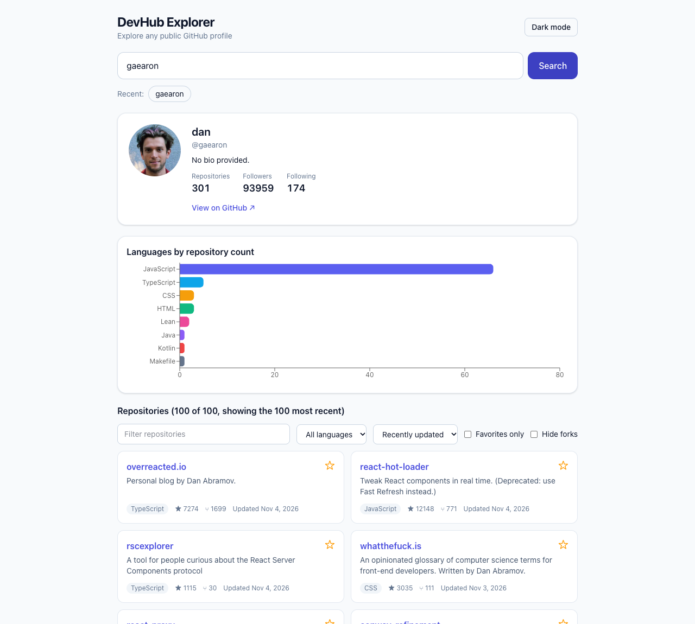

# DevHub Explorer

Search any public GitHub profile and explore its repositories. Built with React, TypeScript, Tailwind CSS and TanStack Query against the GitHub REST API.



**Live demo:** https://shreybillade3-hub.github.io/devhub-explorer/

## Features

- Debounced username search (500 ms) plus an explicit Search button
- Profile card and a language breakdown chart computed from the user's repositories
- Repository list with text filter, language filter, sorting (recently updated, stars, name), "hide forks" and "Show more" pagination
- Favorite repositories and recent searches saved in `localStorage`
- Request cancellation and caching through TanStack Query (`signal` is passed to `fetch`)
- Clear loading, empty, 404 and **rate limit** states (shows when the limit resets)
- Light and dark theme, responsive layout, keyboard-accessible controls

## Tech stack

React 19, TypeScript, Vite, Tailwind CSS v4, TanStack Query, Recharts, Vitest, React Testing Library, GitHub Actions

## Project structure

```
src/
  components/  SearchBar, ProfileCard, RepoCard, RepoControls, LanguageChart, ThemeToggle
  hooks/       useDebounce, useLocalStorage, useTheme
  lib/         github (API client + errors), repos (filter, sort, language stats)
  types.ts
```

## Good to know

The app uses the unauthenticated GitHub API, which allows about 60 requests per hour per IP address. If you hit the limit the app tells you when to try again. Only the 100 most recently updated repositories of a user are loaded.

## Getting started

```bash
npm install
npm run dev
npm test
npm run lint
npm run build
```

## Testing

Unit tests cover filtering, sorting and language statistics, and the API client (success, 404, rate limit and URL encoding). Integration tests mock `fetch` and check the full search flow, filters, favorites persistence, pagination and error handling.
